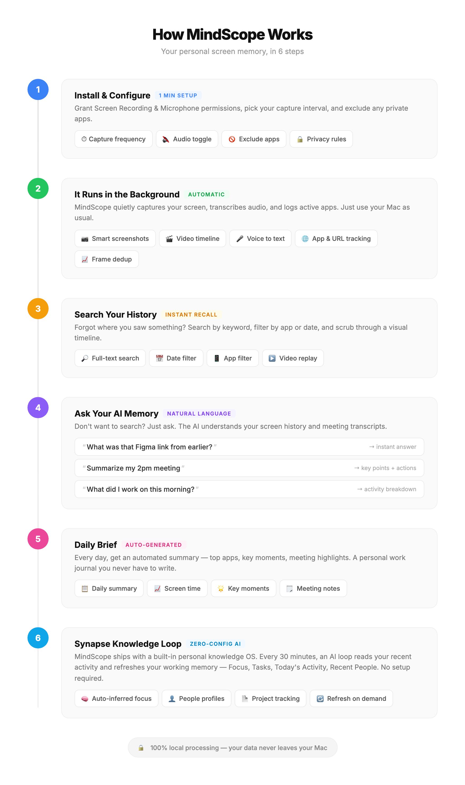
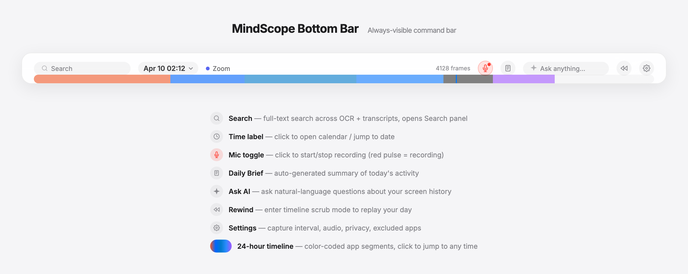

# MindScope

**Your screen memory. Never forget what you saw, heard, or discussed.**

MindScope runs silently in the background, capturing your screen and audio into a searchable, structured knowledge base — processed entirely on your Mac.

<p align="center">
  
</p>

---

## Install

1. Download `MindScope_0.1.0_aarch64.dmg` from [Releases](https://github.com/xanthiawang/mindscope/releases/latest) and drag to Applications.
2. Launch it once; macOS asks for **Screen Recording**. Grant it in System Settings → Privacy & Security → Screen Recording (and **Microphone** when you first press the mic button or a meeting is detected).
3. Install `ffmpeg` for audio recording — `brew install ffmpeg` (any location on your `PATH` or in `~/.local/bin` works).
4. *(Optional)* Install the `claude` CLI for AI features — `npm install -g @anthropic-ai/claude-code` (found via `PATH`, `~/.local/bin`, Homebrew; or set `claude_path` in `~/.mindscope/settings.json`).

**Requirements:** macOS 11+ (meeting detection is most accurate on macOS 14+), Apple Silicon recommended.

---

## The Bar

MindScope lives as a thin bar at the bottom of your screen. Everything starts here.

<p align="center">
  
</p>

| Element | Action |
|---|---|
| **Search** | Full-text search across OCR and meeting transcripts |
| **Time label** | Click to open the calendar and jump to any date |
| **Mic toggle** | Start/stop recording manually (red pulse = recording) |
| **Daily Brief** | Auto-generated summary of today's activity |
| **Ask AI** | Natural-language questions about your screen history |
| **Rewind** | Enter timeline scrub mode to replay your day |
| **Settings** | Capture interval, audio, privacy, excluded apps |
| **24-hour timeline** | Click or drag to jump to any moment; time pill follows your cursor |

Press `Esc` to hide the UI — background recording keeps running.

---

## Core Concepts

### Timeline & Rewind

The bottom bar shows a full 24-hour day at once with color-coded app segments and 3-hour tick marks. Click anywhere to jump to that moment; a red scrubber marks your current position. In rewind mode, a time pill follows your mouse showing the exact minute at the cursor, and two-finger swipe scrolls through history. Rewind past midnight to cross into the previous day.

### Search

Full-text FTS5 search runs against OCR-extracted text from every frame. Results highlight matching regions with yellow boxes on the screenshot. Filter by app, date range, or switch to the Meetings tab to browse session transcripts.

### Meetings

MindScope auto-detects active meetings by combining two signals: a known meeting app is running (Zoom, Tencent Meeting, Teams, Google Meet, Webex, FaceTime, Lark, DingTalk, WeMeet, Discord) **and** the microphone is actively in use. Both must be true to avoid false positives from dictation tools like Wispr Flow or superwhisper.

When detected, MindScope streams audio to a local multilingual Whisper model (`ggml-base.bin`, 141 MB, Metal-accelerated on Apple Silicon). Transcripts appear in real time in the AI panel's Transcript tab. End-to-end latency is 2–4 seconds.

**Sessions are activity-based, not time-based:** one Zoom meeting = one session, even if it spans hours. A manual 10-minute recording is a separate session. Find them under Search → Meetings as clickable cards with colored app badges and full transcripts.

### Synapse — three-tier memory, fully local

On first launch, MindScope bootstraps a local AI loop called **Synapse** into `~/.mindscope/synapse/` and seeds `~/.mindscope/vault/` with memory templates. Every 30 minutes (or on-demand from the Brief panel), Synapse reads your recent screen activity + meeting transcripts and patches your memory files via Claude CLI.

Memory is organized in three tiers — just like human memory:

| Tier | File | Purpose |
|---|---|---|
| 🔥 **Hot** | `_working-memory.md` | What you're doing *right now* — today's focus, recent apps, active people |
| 🌤 **Warm** | `_warm-memory.md` | Rolling context — follow-ups, project momentum, collaborator state |
| ❄ **Cold** | `meet.*.md`, `user.*.md`, `proj.*.md`, `daily.journal.*.md` | Long-term vault, one file per entity |

Synapse uses **Edit-only, section-scoped patches** with hard size caps (4 KB Hot, 8 KB Warm) to prevent memory drift — your manual notes in the `## User Notes` zone are never touched. Background loops route through **Claude Haiku** to keep costs minimal; only the **Ask AI** button uses Sonnet for deep reasoning.

Bundled skills (`command-center`, `daily-journal`, `detect-people`, `sync/vault-updater`) ship with the app. No external install, no OAuth, no cloud.

> 📖 For a walkthrough of how all this works together, see [**How MindScope Works**](docs/HOW_IT_WORKS.md).

---

## Privacy & Data

Everything is local. No data leaves your Mac. All files live under `~/.mindscope/`:

```
~/.mindscope/
├── data/
│   ├── frames/          # JPEG screenshots by date
│   ├── segments/        # HEVC video
│   ├── audio/           # Audio chunks + transcripts
│   └── mindscope.db     # SQLite + FTS5 index
├── vault/               # Markdown knowledge base
│   ├── _working-memory.md   # 🔥 Hot tier (≤ 4 KB)
│   ├── _warm-memory.md      # 🌤 Warm tier (≤ 8 KB)
│   ├── meet.*.md            # ❄ Auto-created per session
│   ├── daily.journal.*.md   # ❄ End-of-day summaries
│   └── user.*.md            # ❄ Person profiles
├── synapse/             # AI skill definitions
├── models/
│   └── ggml-base.bin    # Multilingual Whisper
└── settings.json        # incl. ffmpeg_path / claude_path overrides, storage_budget_mb
```

Swift helpers ship inside the app bundle, not in `~/.mindscope`. Set `MINDSCOPE_HOME` to relocate the whole tree.

**Typical storage:** ~400 MB/day with default settings. Adjust retention in Settings.

**Privacy features:** PII auto-redaction (credit cards, IDs, phone numbers), configurable app exclusion list, private browsing mode that skips Incognito windows. MindScope is also self-excluded from its own captures.

---

## Build from Source

Prerequisites (one-time):

```sh
xcode-select --install                 # Swift toolchain for the helper CLIs (swiftc)
brew install rustup cmake              # Rust via rustup; cmake builds whisper.cpp
rustup toolchain install stable        # Homebrew's rustup puts cargo in $(brew --prefix rustup)/bin
export PATH="$(brew --prefix rustup)/bin:$PATH"
brew install ffmpeg                    # audio capture (runtime dependency)
```

Build:

```sh
git clone https://github.com/xanthiawang/mindscope.git
cd mindscope
npm install
npm run tauri build
```

`src-tauri/build.rs` compiles every Swift helper in `src-tauri/swift/` (`ocr_helper`, `hevc_encoder`, `frame_reader`, `screen_info`, `active_app`, `system_audio`, `is_meeting`, `topmost_window`) and bundles them as sidecars inside `MindScope.app/Contents/MacOS/`. Nothing needs to be pre-installed in `~/.mindscope/bin`.

Output at `src-tauri/target/release/bundle/dmg/MindScope_0.1.0_aarch64.dmg` (`.app` under `bundle/macos/`).

Development:

```sh
npm run tauri dev      # Vite + cargo run; helpers are copied to src-tauri/target/debug/
cd src-tauri && cargo test --lib     # unit tests (PII, local-time, text helpers)
```

Set `MINDSCOPE_HOME=/some/throwaway/dir` to run against an empty data directory instead of `~/.mindscope` (settings, DB, frames, vault all live under it). Screen Recording permission is granted per app bundle, so for permission-dependent testing run the built `.app` rather than the dev binary.

---

## Troubleshooting

**Screenshots show only the desktop wallpaper.** TCC Screen Recording permission is stale. Run `tccutil reset ScreenCapture com.mindscope.rewind`, re-grant under System Settings, then quit and relaunch.

**Meeting detected but no transcription.** Check `ffmpeg` is on your `PATH` (or set `ffmpeg_path` in `~/.mindscope/settings.json`) and the Whisper model exists at `~/.mindscope/models/ggml-base.bin`. The app log lists the resolved `ffmpeg`/`claude` paths at startup.

**MindScope not in Privacy → Microphone.** Click the mic button in the bar — macOS will show the permission dialog on first use.

**Synapse loop not updating working memory.** Install the Claude CLI (`npm install -g @anthropic-ai/claude-code`) and verify `claude -p "hi"` works in a terminal. The loop routes through Claude Haiku, skips passes when nothing new was recorded, and stops after `claude_daily_budget` calls per day (default 120, in `settings.json`).


---

## License

MIT — Copyright (c) 2026 Zixin Wang
